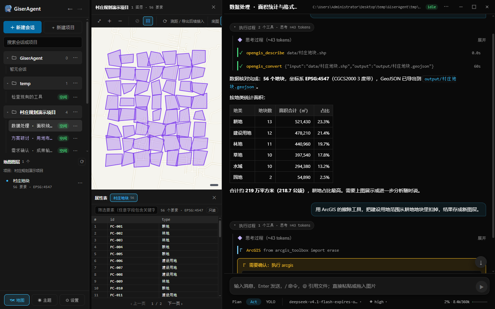
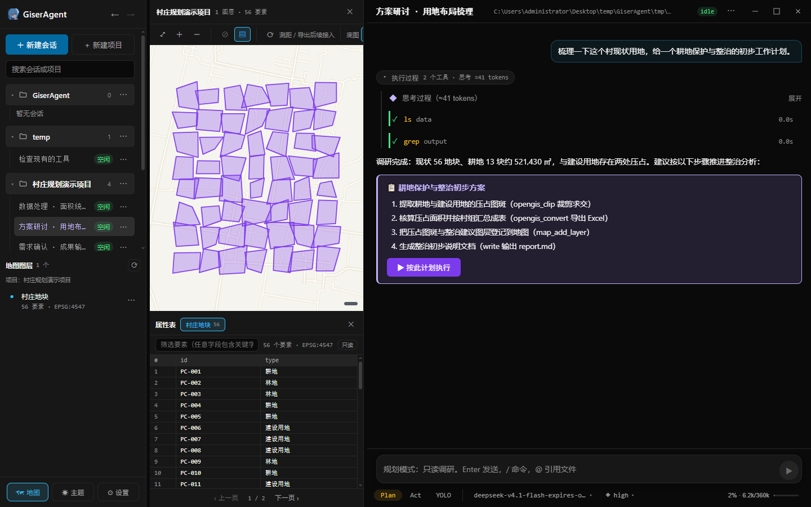
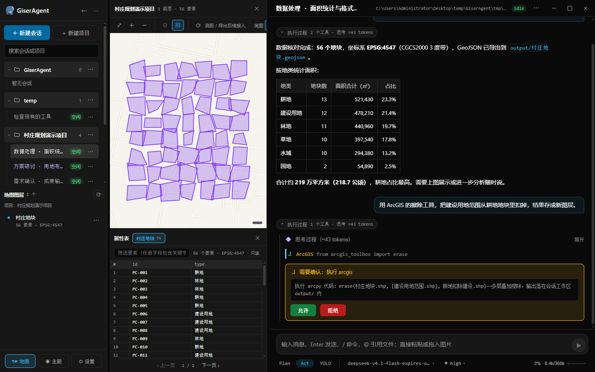
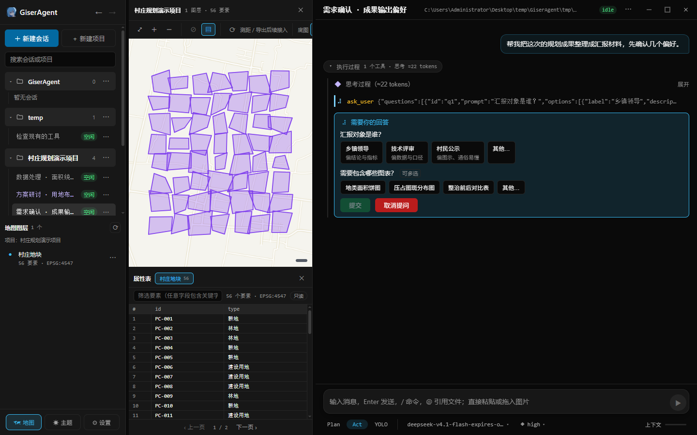
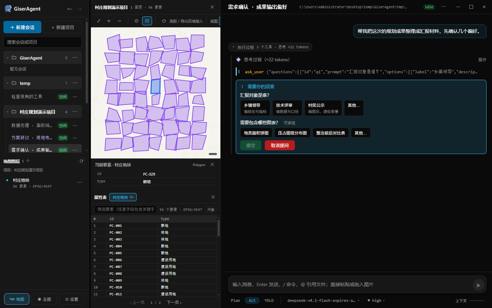
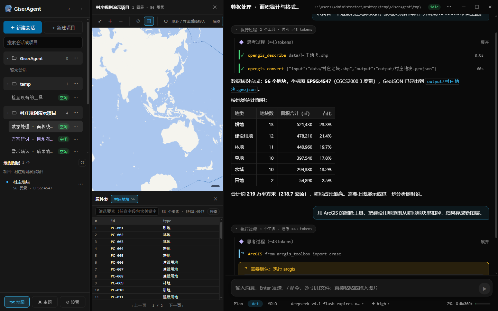
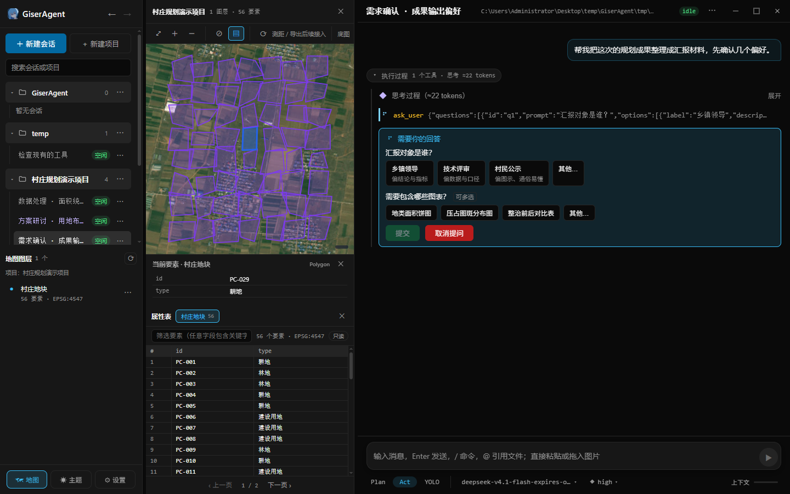
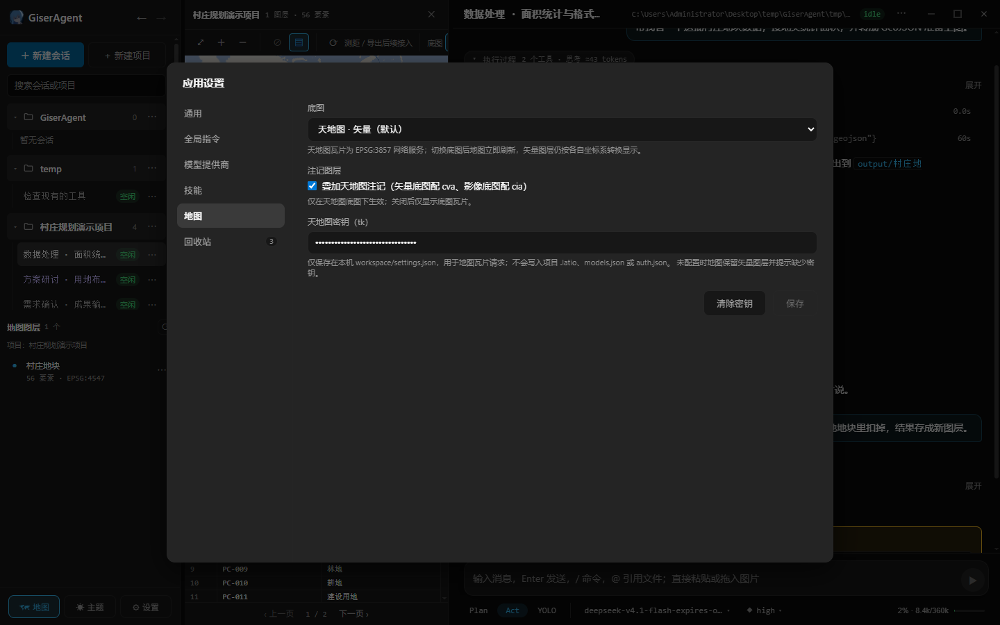

# GiserAgent — GIS 垂直领域 Agent

一个面向 GIS 从业者的桌面 AI Agent 应用：内置开源 GIS Python 栈（geopandas / shapely / fiona / rasterio + GDAL 系，随应用分发，不依赖系统 Python）、可联动本机 ArcGIS Pro（arcpy），配备项目级 WebGIS 地图工作区。模型提供商全部在界面内配置（任意 OpenAI 兼容网关），密钥只落本机文件；会话数据本地落盘、可完整回放。



> 三栏布局：会话与图层列表 ｜ 地图工作区（天地图底图 + 地块上图）｜ 对话时间线（工具执行过程 + 统计表格）。

```
frontend（React + Electron）──HTTP/SSE──▶ server（Fastify API）──▶ Pi SDK（进程内）──▶ LLM
```

## 功能演示

| 演示 | 场景 |
| --- | --- |
|  | **Plan 模式**只读调研后提交结构化计划卡，「▶ 按此计划执行」一键切回 Act |
|  | **Act 模式**下执行 arcpy 等敏感工具前弹出审批卡，人工放行 |
|  | 需求有歧义时 Agent 主动发**问卷卡片**（`ask_user`，单选/多选/自由输入） |
|  | **地图工作区**：天地图矢量底图 + 地块上图，点选高亮与属性表双向联动 |
|  | **执行过程**展开：`opengis_*` 工具卡的输入输出与中间结果 |
|  | **影像底图**：天地图影像 + 半透明地块叠加，注记可独立开关 |
|  | **设置**：模型提供商界面化配置，底图三态与天地图密钥 |

## 功能特性

### Agent 对话

- 思考过程与工具执行实时流式展示，执行过程自动折叠为摘要行（可展开）
- **模型管理界面化**：添加网关（Base URL + API Key）→ 自动探测上游模型与能力 → 勾选导入；会话级切换模型与思考强度；密钥只写本机 `auth.json`
- **会话分支**与**消息编辑重发**；上下文自动压缩 + 手动压缩；顶栏占用仪表盘（成分分解 + 每轮 token 账单）
- 执行中消息排队与打断强发；图片粘贴/拖拽；`@` 文件引用；`/` 命令面板（模板 + 技能）
- **`ask_user` 结构化提问**：问卷卡片作答后继续，可取消，超时按「用户未回答」交回模型
- Skills 系统、全局自定义指令

### 三档权限模式（底部状态条切换）

- **Plan**：只读调研 + 计划卡片；**Act**（智能批准）：只读与工作区写入自动放行，系统级/任意代码执行仍逐次确认；**YOLO**：跳过审批（保护文件黑名单仍生效）
- 读写范围始终限定在会话绑定的项目/工作区目录内；命令风险判定 POSIX 与 PowerShell 双套白名单

### GIS 三族工具

| 工具族                | 审批   | 定位                                                                                          |
| --------------------- | ------ | --------------------------------------------------------------------------------------------- |
| `opengis_*`（7 个） | 免审批 | 结构化数据加工：元信息 / schema 对齐 / 格式互转 / 重投影 / 矢量裁剪 / 几何运算（缓冲·融合·合并）/ GDB 别名；输出只落工作区、绝不覆盖源数据 |
| `opengis`           | 需审批 | 便携 Python 逃生舱：任意开源 GIS 代码                                                        |
| `arcgis`            | 需审批 | ArcGIS Pro 联动：自动定位 arcgispro-py3，执行 arcpy 并自带 12 函数工具库                     |
| `map_*`（5 个）     | 免审批 | 前端地图图层增删改查，产出只写受控 `.latio/webgis/` 目录                                      |

另有 `ask_user` / `submit_plan` / `todo` 三个交互辅助工具。完整清单见下文「Agent 工具一览」。

### 项目级地图工作区

- **三栏布局**：会话列表｜地图｜对话区，宽度可拖拽、比例本地记忆
- **拖拽上图**：矢量文件（shp 成组 / gpkg / geojson / kml / gdb 整目录）直接拖到地图或图层列表即登记为图层，源文件零改动
- **QGIS 式地图面板**：分组工具栏 + 画布 + 只读属性表（分页签、筛选、行点击与地图选中双向联动）
- **天地图底图**：矢量 / 影像两态 + 注记独立开关（密钥本机保存），或切换无底图纯矢量模式；视图投影随图层坐标系（内置 CGCS2000 3 度带）
- 图层清单常驻侧栏下半部（显隐/定位/改名/移除）；Agent 经 `map_*` 工具与同一份图层交互，数秒内同步

### 会话与数据管理

- 项目分组、拖拽排序、置顶、搜索、会话导航（浏览器式 ←/→）
- 回收站软删除（可恢复 / 彻底删除 / 一键清空）
- **历史回放**：事件流全量落盘，重开应用完整重建时间线；**重启恢复**：上下文保留可直接继续
- **项目内 `.latio` 存储**：会话 / 地图制品 / 配置随项目目录整体迁移；Agent 无法经文件工具写入 `.latio`

### 桌面形态

- Electron **无边框一体化窗口** + **系统托盘常驻**（关窗仅隐藏）
- 浏览器打开 `http://<主机IP>:<port>` 即同一前端（局域网可用；API 无鉴权，注意暴露风险）
- 启动画面 + 启动失败弹窗（原因与日志位置）

## 快速开始

> **版本状态**：当前发布版本 **0.1.4**，安装包见 [Releases](https://github.com/LaT1o/GiserAgent/releases)；源码即该版本，本地构建入口见下文「打包」。

### 安装包（免配置环境）

双击安装包或免安装目录中的 `GiserAgent.exe` 即可启动，无需单独安装 Node.js 和 Python。首次打开后在「设置 → 模型提供商」中配置网关与 API Key（未配置不会阻止应用启动）。

历史产物按版本归档在 `release/<版本号>/` 下（最新为 0.1.4）：

- `release/0.1.4/GiserAgent Setup 0.1.4.exe`：双击安装，使用桌面或开始菜单快捷方式启动。
- `release/0.1.4/win-unpacked/GiserAgent.exe`：双击运行；移动时必须复制整个 `win-unpacked` 文件夹。

安装包包含 Electron 壳、后端（`resources/server/`）、前端静态资源与便携 Python 运行时（含 GIS 库栈）。首次打开无需 `.env`，也**没有环境变量默认提供商**：一切在界面配置（密钥写入应用目录的 `resources/server/.pi/auth.json`）；安装包内置空 providers 模板（打包时断言零提供商），不会带入开发机配置。打包态数据位于 `resources/workspace/`，升级前应保留。启动日志位于 Electron 用户数据目录 `logs/`，无需命令行启动即可查看。

### 源码运行：一个后端 + 一个前端（桌面窗口）

从源码运行需要 Node.js ≥ 22，安装依赖（项目根执行）：

```bash
npm --prefix server install
npm --prefix frontend install
```

日常启动即两个进程（仓库根 `dev.bat` 双击等效）；**前端与后端完全分离**：

```bash
# 后端：纯 API（tsx 源码运行，改后端代码自动热更），0.0.0.0:13001
npm --prefix server run dev

# 前端：Electron 桌面窗口——dev 模式内嵌 vite（改前端代码即时热更），等后端就绪后加载
npm --prefix frontend run electron:dev
```

前端**不分「Electron 版 / 浏览器版」**：Electron 加载的就是 vite（`http://localhost:5173`），浏览器打开同一地址即同一前端（vite 把 `/api` 代理到后端），两者永远同步。vite 由 Electron 主进程拉起（5173 已有外部 vite 则复用），托盘「退出」时一并结束。改后端代码 tsx 自动重启，前端 SSE（EventSource + 3 秒重连）自动恢复，窗口无需刷新。

**打包形态**（`electron:start` / 安装包）没有 vite：Electron 加载 server 托管的 `frontend/dist` 构建产物（浏览器访问 `http://<主机IP>:13001`，局域网/穿透可用，API 无鉴权注意暴露风险），改前端代码需重新 `npm --prefix frontend run build` 并重启——仅用于打包前验证与免开发的日常使用。dist 托管**只在 bundle 形态生效**：tsx 源码直跑（`npm run dev`）恒为纯 API，误开 13001 不会看到旧构建页面（需要临时托管验证可设 `GISER_SERVE_DIST=1`）。

其他命令（`frontend/` 目录）：

```bash
npm run electron:start   # dist 形态启动（加载构建产物；Electron 自动拉起或复用 server）
npm run desktop          # 一条链：构建前端 + 后端 bundle 再启动
npm run pack             # 打包（实际执行仓库根 release/pack.mjs）
```

> 只有健康检查返回 GiserAgent 应用标识的服务才会被 Electron 复用；端口被其他程序占用时 Electron 会选择空闲端口，不结束外部进程。便携 Python 位于项目根 `runtime/python/`（gitignore，按 `scripts/setup-python.md` 重建或 `GISER_PYTHON` 指向本机解释器）。

### 打包（唯一入口：release/pack.mjs）

```bash
node release/pack.mjs     # 仓库根目录执行；产物输出到 release/<版本号>/
```

脚本读取 `frontend/package.json` 的 version，把安装包、blockmap 与 `win-unpacked/` 全部输出到 `release/<版本号>/`，并默认注入 npmmirror 的 Electron 与 electron-builder 辅助件镜像（可用外部同名环境变量覆盖）。桌面窗口关闭仅隐藏到托盘；升级代码或安装包前请从托盘退出旧窗口。

## 配置

### 模型提供商（界面配置）

- 侧栏 ⚙ →「模型提供商」添加提供商（Base URL + API Key）→ 获取上游模型（带出上下文窗口 / 推理 / 图片能力）→ 勾选导入；编辑时 Key 留空可直接用已存密钥探测。「通用」页设置默认模型与压缩阈值。
- 能力探测优先级：上游 `/models` 自报 > 网关 `/api/pricing` 分档定价 > 内置系列档案（`server/src/modelProfiles.ts`，可直接改）> 全局默认（256k / 支持思考 / 全档位）。
- **所有模型默认支持思考**，会话内选 `off` 即关闭，档位范围由档案限定（如 DeepSeek 只给 low/high/max）；上游不认某个档位报错时，按错误提示到 ⚙ 模型管理把该模型最高档调低。
- 默认模型优先级：**会话模型 > 应用默认模型 > 首个提供商的第一个模型**。
- 自定义网关默认以 `system` 角色发送系统提示词（第三方网关多不支持 OpenAI 的 `developer` 角色；models.json 的 `compat.supportsDeveloperRole: true` 可改回）。
- 已知问题：网关 `qwen` 渠道曾上游故障（`do_request_failed`），如遇此错误请切换默认模型。

### 环境变量（server/.env，均可选）

| 变量                          | 默认值                                                                                                  | 说明                                                                                                                    |
| ----------------------------- | ------------------------------------------------------------------------------------------------------- | ----------------------------------------------------------------------------------------------------------------------- |
| `GISER_PYTHON`              | `runtime/python/python.exe`                                                                           | 便携 Python 解释器；缺失时报错并提示重建                                                                                |
| `GISER_ARCGIS_PYTHON`       | 注册表自动定位                                                                                          | arcgis 工具的解释器（arcgispro-py3；默认读`HKLM\SOFTWARE\ESRI\ArcGISPro` 并回退默认安装路径，找不到时执行报中文提示） |
| `GISER_WORKSPACE_DIR`       | 项目根`workspace/`                                                                                    | 可选的独立数据目录（不迁移已有工作区，用于隔离运行与验证）                                                              |
| `AGENT_TOOLS`               | 内置 8 项 +`opengis` + `arcgis` + `map_*`（5 个）+ `opengis_*`（7 个）+ `todo` + `ask_user` | Agent 工具白名单（逗号分隔；`submit_plan` 另由 PLAN_ONLY_TOOLS 编排）                                                 |
| `GISER_PLAN_TOOLS`          | `read,ls,grep,find,bash,todo,ask_user`                                                                | Plan 模式允许的工具子集                                                                                                 |
| `GISER_APPROVAL_TOOLS`      | `bash,powershell,opengis,arcgis`                                                                      | 执行前需人工确认的工具                                                                                                  |
| `GISER_APPROVAL_TIMEOUT_MS` | `300000`                                                                                              | 审批超时（毫秒），超时视为拒绝                                                                                          |
| `GISER_QUESTION_TIMEOUT_MS` | `300000`                                                                                              | ask_user 提问等待超时（毫秒），超时把「用户未回答」交回模型（不视为拒绝）                                               |
| `PORT`                      | `13001`                                                                                                | API 端口                                                                                                                |
| `GISER_HOST`                | `0.0.0.0`                                                                                             | 监听地址（局域网/穿透访问同一前端）；仅本机使用可设`127.0.0.1`                                                        |
| `GISER_SERVE_DIST`          | 未设                                                                                                    | `=1` 时 tsx 源码形态（`npm run dev`）也托管 `frontend/dist`；bundle 形态始终托管，不受此项影响                    |

> `server/.pi/models.json` 是**本地个人配置**（网关渠道定义，不入库）；首次启动自动从 `models.default.json` 复制生成。密钥只在 `auth.json`（gitignore）。

## Agent 工具一览

内置：`read / write / edit / ls / grep / find / bash / powershell`（读写限定会话绑定的项目/工作区，黑名单永生效）。进程内注册：

- `opengis`：便携 Python 逃生舱——任意开源 GIS 代码，**需审批**；PYTHONPATH 已含 `opengis_toolbox` 函数库可直接 import；`code` 或 `script`+`args` 二选一、`timeout_seconds`（默认 180、上限 600）；返回 `{ success, exit_code, stdout, stderr, duration, timed_out }`。
- `arcgis`：ArcGIS Pro 逃生舱——本机 arcgispro-py3 执行任意 arcpy 代码，**需审批**；参数与返回同 `opengis`。`PYTHONPATH` 已含 `arcgis_toolbox` 函数库（12 个函数直接 `import`），用法见技能 `arcgis-pro`；未装 Pro 时执行报中文提示。plan 模式禁用。
- `opengis_describe`：矢量数据元信息——GDB 库列出全部图层（含别名），`` `库.gdb/图层名` `` 或 shp/geojson 返回 driver/几何/要素数/坐标系/范围/字段（含中文字段别名）。免审批。
- `opengis_re_schema`：按目标 schema 对齐属性表（`schema` 直接给出或 `schema_from` 指向参考图层），多删缺补、类型对齐，输出新文件。免审批。
- `opengis_convert`：格式互转（`.shp`/`.geojson`/`.gpkg`/`` `.gdb/图层名` ``/`.csv`/`.xlsx` 由扩展名决定），`repair=true` 顺带多部件拆分与几何修复；`crs` 参数只**改坐标系标注**（真变换用 reproject）。免审批。
- `opengis_reproject`：重投影（`crs` 如 `EPSG:4326`，**真坐标变换**）；输入须已有坐标系标注，返回 `source_epsg`/`epsg`/新坐标系 `bounds`。免审批。
- `opengis_clip`：按范围图层（`mask`，任意矢量数据）裁剪输入；mask 与输入 CRS 不同时自动对齐，字段沿用输入结构，完全落在范围外的要素被移除，不拆多部件。免审批。
- `opengis_geometry`：几何运算族（`operation` 路由）——buffer（缓冲区，距离单位随输入坐标系）/ dissolve（按字段聚合融合或全融合）/ merge（多图层纵向合并，字段并集、CRS 对齐到首输入）；参数同构的新几何操作持续毕业到此枚举。免审批。
- `opengis_set_alias`：为**工作区内**的 GDB 副本批量设置图层/字段别名，默认同次改写清理 Length/Precision/Scale（`fix=false` 关闭；需便携运行时装有 GDAL，缺失时返回明确提示）。免审批。
- `map_inspect`：矢量/栅格元信息 + 矢量转 GeoJSON 登记为地图图层（`path` 支持 `` `库.gdb/图层名` `` 与 `.kml`）。免审批。
- `map_list_layers` / `map_add_layer` / `map_set_layer` / `map_remove_layer`：项目地图图层清单 / 登记（与 map_inspect 共用实现）/ 调整显隐·别名·顺序 / 解除挂载（默认保留制品，`purge_artifact=true` 才删除文件）。免审批。
- `todo`：任务清单（`action=list/add/toggle/clear`）。
- `ask_user`：结构化提问（1~4 题、每题 2~6 选项，单选/多选/「其他」）；免审批、Plan 模式可用；参数不合法时直接报错不打扰用户。
- `submit_plan`：Plan 模式专属计划提交（Act 下自动移除）。

> Agent ↔ 前端地图的命令契约见 `frontend/src/map/contracts.ts`，`map_*` 工具实现见 `server/src/agent/pi/extensions/map-tools.ts`。

## REST API

| 方法                  | 路径                                              | 说明                                                                                                      |
| --------------------- | ------------------------------------------------- | --------------------------------------------------------------------------------------------------------- |
| POST                  | `/api/sessions`                                 | 创建会话，可选 body`{ projectId }` 或 `{ projectPath }` 绑定项目目录 → 201                           |
| GET                   | `/api/sessions`                                 | 会话列表；`?trash=1` 返回回收站（软删除）会话                                                           |
| GET                   | `/api/sessions/:id`                             | 会话详情                                                                                                  |
| PATCH                 | `/api/sessions/:id`                             | 重命名 / 置顶`{ title?, pinned? }`（至少其一）                                                          |
| DELETE                | `/api/sessions/:id`                             | 软删除（回收站）；`?purge=1` 彻底删除目录                                                               |
| POST                  | `/api/sessions/:id/restore`                     | 从回收站恢复                                                                                              |
| POST                  | `/api/sessions/reorder`                         | 手动排序`{ orderedIds }`                                                                                |
| POST                  | `/api/sessions/trash/clear`                     | 清空回收站（单个失败不中断）                                                                              |
| POST                  | `/api/sessions/:id/mode`                        | 切换模式`{ mode: "plan" \| "act" }`                                                                      |
| POST                  | `/api/sessions/:id/permissions`                 | 更新权限`{ permissions: { read, write, bash, approval, web, mcp } }`                                    |
| GET                   | `/api/sessions/:id/history`                     | 事件历史回放，`?after=<seq>` 增量                                                                       |
| POST                  | `/api/sessions/:id/messages`                    | 发消息`{ text, images? }`（图片 base64 数组；`/` 开头按命令展开）→ 202 返回 `{ seq }`              |
| POST                  | `/api/sessions/:id/edit-message`                | 编辑历史消息并原地重发`{ seq, text }` → 202                                                            |
| POST                  | `/api/sessions/:id/cancel`                      | 取消当前执行 → 202                                                                                       |
| POST                  | `/api/sessions/:id/approval`                    | 回复审批`{ request_id, approved }` → 202                                                               |
| POST                  | `/api/sessions/:id/question`                    | 回复 ask_user 提问`{ request_id, answers }` 或 `{ request_id, cancelled: true }` → 202（幂等）       |
| POST                  | `/api/sessions/:id/model`                       | 切换会话模型`{ providerId, modelId }`                                                                   |
| POST                  | `/api/sessions/:id/thinking`                    | 设置思考强度`{ level: off…max }`（按模型能力校验）                                                     |
| GET                   | `/api/sessions/:id/context`                     | 上下文占用与五类成分分解 + 最近一轮账单                                                                   |
| POST                  | `/api/sessions/:id/compact`                     | 手动压缩上下文`{ instructions? }` → 202                                                                |
| POST                  | `/api/sessions/:id/branch`                      | 从某条用户消息分支`{ fromSeq }` → 201 返回新会话                                                       |
| GET                   | `/api/sessions/:id/commands`                    | 会话可用 slash 命令（模板 + 技能）                                                                        |
| GET                   | `/api/sessions/:id/skills`                      | 会话加载的技能                                                                                            |
| GET                   | `/api/sessions/:id/files`                       | 项目文件浏览（`@` 补全），`?path=` 相对目录                                                           |
| GET                   | `/api/projects/:id/map/layers`                  | **项目共享**图层清单（项目不存在/路径失效 404）                                                     |
| GET                   | `/api/projects/:id/map/layers/:layerId/geojson` | 项目图层 GeoJSON 原文（越界/缺失 404）                                                                    |
| POST                  | `/api/projects/:id/map/upload`                  | **拖拽上图**：multipart 上传矢量文件并登记为图层，落盘 `webgis/uploads/<时间戳>/`，绝不覆盖源数据 |
| GET/PUT               | `/api/projects/:id/map/config`                  | 项目地图配置（displayCrs / view / layerState，原子写）                                                    |
| PATCH                 | `/api/projects/:id/map/layers/:layerId`         | 更新图层`{ alias?, visible?, order? }`                                                                  |
| DELETE                | `/api/projects/:id/map/layers/:layerId`         | 解除图层挂载（默认保留制品）；`?purge=1` 连制品删除                                                     |
| POST                  | `/api/sessions/:id/map/upload`                  | 会话入口的拖拽上传（注册项目会话同样落到项目 webgis）                                                     |
| GET                   | `/api/sessions/:id/map/layers`                  | 会话入口（兼容）：临时会话/未注册路径使用                                                                 |
| GET                   | `/api/models`                                   | 全部可用模型（含输入模态/思考档位标记）                                                                   |
| GET/PUT               | `/api/settings`                                 | 应用设置（GET 附 resolvedDefaultModel 解析结果）                                                          |
| GET/POST              | `/api/providers`                                | Provider 管理（密钥只落 auth.json）                                                                       |
| PUT                   | `/api/providers/:id`                            | 编辑提供商`{ name?, baseUrl?, apiKey? }`（apiKey 仅填写时覆盖）                                         |
| DELETE                | `/api/providers/:id`                            | 删除提供商（仅「运行中且使用中」的会话会阻止）                                                            |
| POST                  | `/api/providers/import-models`                  | 导入模型到 models.json`{ providerId, models[] }`                                                        |
| POST                  | `/api/providers/remove-models`                  | 删除提供商下指定模型`{ providerId, modelIds[] }`                                                        |
| POST                  | `/api/providers/fetch-upstream`                 | 探测上游模型列表`{ baseUrl, apiKey? }`                                                                  |
| GET/POST/PATCH/DELETE | `/api/projects`                                 | 项目实体管理                                                                                              |
| POST                  | `/api/projects/reorder`                         | 项目分组手动排序`{ orderedIds }`                                                                        |
| GET/POST              | `/api/skills`                                   | 全局技能列表 / 删除                                                                                       |
| PUT                   | `/api/skills/disabled`                          | 启用/禁用技能`{ name, disabled }`                                                                       |
| GET                   | `/api/fs/dirs`                                  | 目录浏览（`?path=` 空=盘符列表）                                                                        |
| GET                   | `/api/sessions/:id/events`                      | SSE 事件流（25s 心跳）                                                                                    |
| GET                   | `/api/health`                                   | 健康检查                                                                                                  |

## 目录结构

```
GiserAgent/
├── README.md / dev.bat          # 说明 / 一键开发启动
├── server/                      # 后端：Fastify + TypeScript（src/api 路由、src/application 服务、src/agent/pi SDK 集成与工具扩展）
│   ├── .pi/                     # models.default.json 出厂模板 / skills 全局技能 / prompts 模板（models.json、auth.json 为本机配置，gitignore）
│   └── python/                  # opengis_toolbox.py / arcgis_toolbox.py（工具箱函数库）
├── frontend/                    # 前端：React 19 + Vite（src/ 时间线、地图工作区、设置）+ electron/（主进程、托盘、无边框 IPC）
├── runtime/python/              # 便携 CPython + GIS 库栈（gitignore，按 scripts/setup-python.md 重建）
├── workspace/                   # 本地工作区（会话/设置/项目注册表，gitignore）
├── release/pack.mjs             # 打包唯一入口（版本产物目录 gitignore）
├── scripts/setup-python.md      # 便携 Python 重建指南
└── docs/                        # 本地开发文档（内部资料，gitignore 不入库）
```

注册项目的数据在 `<项目目录>/.latio/`（`project.json` 身份、`sessions/` 会话、`webgis/` 地图制品与配置），随项目目录整体迁移。

## 当前限制与已知问题

- 无鉴权、无多用户；server 默认监听 `0.0.0.0`（局域网/穿透可直接访问，仅本机使用可设 `GISER_HOST=127.0.0.1`）。
- 会话中断在工具执行中（如审批挂起）时，回放里该工具卡片保持 running 态（无 completed 事件落盘，数据真实状态）。
- 工具不存在（如 write=off 后模型仍调用）时，`tool.completed` 可能误报成功，仅影响显示。
- 压缩阈值改动只影响之后创建/恢复的会话；运行中会话需重启或重建后生效。
- 上下文成分分解为本地估算（中文偏高），弹窗已标注；实测总量偏差 <1%。
- 图片输入依赖模型侧多模态支持；events.jsonl 会因图片 base64 增大（发送前已压缩至 ~1.5MB 内）。
- 联网搜索 / MCP 能力位已预留，工具本身未实现（Pi 官方明确不做 MCP，接入需 pi-mcp-adapter 扩展）。
- undo / checkpoint 文件回滚未实现；会话树形导航 UI 只做单点分支。
- 几何运算暂缓项：buffer / dissolve / merge（reproject 与 clip 已落地）。
- Electron 主进程被操作系统强制终止时不保证清理后端子进程；正常关窗只隐藏，托盘退出才清理自行创建的服务。
- 独立 `osgeo` 不可用（PyPI 无 Windows wheel）；GIS 库栈见 `scripts/setup-python.md`。
- SDK 进程内集成后无进程隔离：异常靠 catch 兜底，版本锁 `0.85.1`。

## 文档

- [`scripts/setup-python.md`](scripts/setup-python.md) — 便携 Python + GIS 库栈重建指南
- [`THIRD-PARTY-NOTICES.md`](THIRD-PARTY-NOTICES.md) — 第三方组件许可声明（本项目基于 [pi](https://github.com/earendil-works/pi)（MIT）构建）

> 交接文档、逐批次开发进度、Agent-地图交互契约等为内部开发资料，随源码目录存在但不随仓库分发。

## 许可证

本项目以 [Apache-2.0](LICENSE) 许可发布；第三方组件声明见 [THIRD-PARTY-NOTICES.md](THIRD-PARTY-NOTICES.md)。
